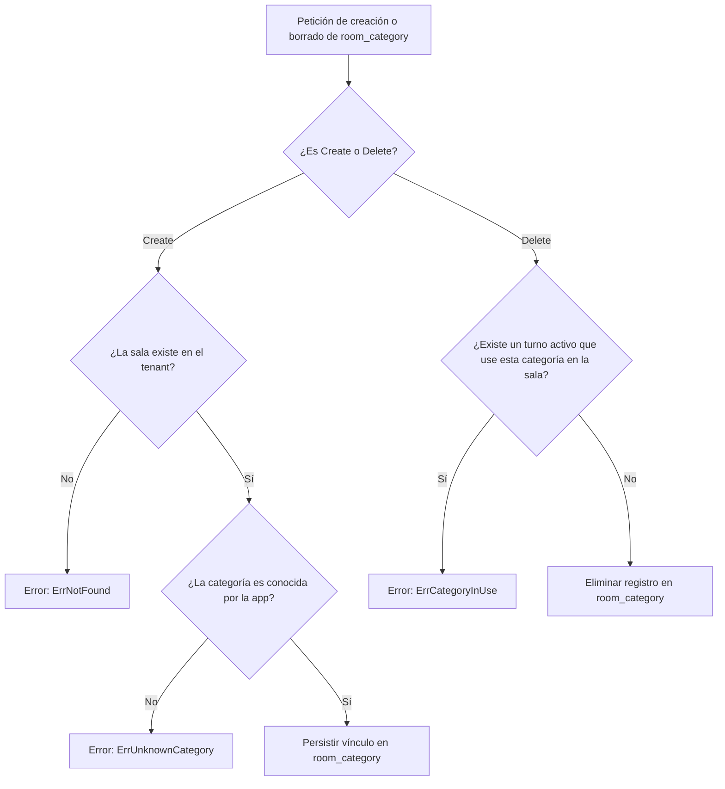

# Reglas de Vinculación Sala-Categoría (`room_category`)

Este flujo se ejecuta al asociar o desvincular una especialidad o categoría de atención a una sala (`room_category.create` y `room_category.delete`, así como los métodos `SetRoomCategories` y `ListRoomCategories`).
Pruebas que lo verifican: [TestRoomCategory_UnknownCategoryRejected](../../tests/rules_test.go), [TestRoomCategory_DeleteInUseRefused](../../tests/rules_test.go) y [TestCategoryOperations](../../tests/category_test.go).

## Recorrido paso a paso

1. **Creación — Existencia de sala**: Se consulta la sala en la transacción (`checkRoomExists`). Si no existe en el inquilino o el identificador es inválido, la operación se rechaza con `ErrNotFound`.
2. **Creación — Categoría conocida**: Se obtienen las categorías globales desde `Deps.Categories.CategoryOptions(tenantID)` (`categoryIn`). Si la categoría solicitada no está en la lista entregada por la aplicación, se rechaza con `ErrUnknownCategory` apuntando al campo `category_id`.
3. **Creación — Escritura**: Si ambas condiciones se cumplen, el motor `crud` almacena el vínculo `(room_id, category_id)` de forma transaccional.
4. **Eliminación — Verificación de turnos activos**: Antes de deshabilitar la categoría en la sala, `checkCategoryNotInUse` busca en `room_shift` si existen turnos activos que la utilicen en dicho espacio. Si se encuentra al menos un turno vigente, se rechaza con `ErrCategoryInUse` (`model.ErrorConflict`).
5. **Eliminación — Borrado seguro**: Cuando no quedan turnos activos asociados a esa especialidad en la sala, el vínculo se elimina sin restricciones.
