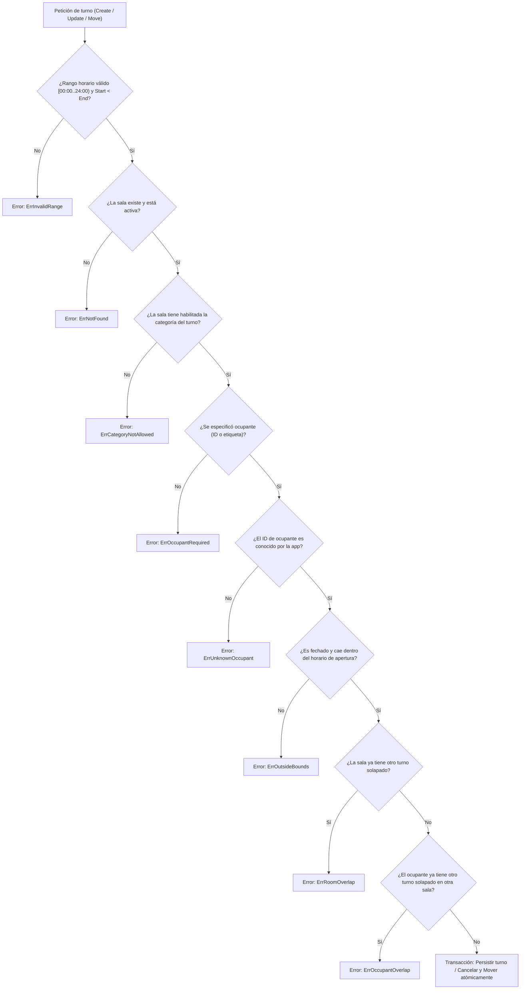

# Reglas de Turnos y Solapamientos (`room_shift`)

Este flujo se ejecuta al guardar, modificar o reubicar un turno (`room_shift.create`, `room_shift.update`, `room_shift_cancellation.create`, y los métodos `SaveShift`, `MoveShiftOccurrence`).
Pruebas que lo verifican: [TestShift_CreateThroughCrud](../../tests/shift_rules_test.go), [TestShift_OverlapRejected](../../tests/shift_rules_test.go), [TestCancellation_MoveCreatesDatedShift](../../tests/shift_rules_test.go) y [TestShiftOverlapCases](../../tests/overlap_test.go).

## Recorrido paso a paso

1. **Rango de horas (`ErrInvalidRange`)**: `checkShift` comprueba que `StartMin < EndMin`, ambos en el intervalo de 0 a 1440 minutos. Si el rango es inconsistente o excede el día, se rechaza inmediatamente con `ErrInvalidRange`.
2. **Existencia y estado de sala (`ErrNotFound`)**: Se verifica que la sala pertenezca al inquilino y que `IsActive` sea verdadero. Una sala inactiva o inexistente responde `ErrNotFound`.
3. **Categoría habilitada (`ErrCategoryNotAllowed`)**: `checkRoomHasCategory` comprueba en `room_category` que la sala esté explícitamente autorizada para la especialidad solicitada. Si no lo está, se emite `ErrCategoryNotAllowed`.
4. **Presencia de ocupante (`ErrOccupantRequired`)**: Todo turno debe identificar al profesional asignado mediante `OccupantId` o `OccupantLabel`. Si ambos están vacíos, se rechaza con `ErrOccupantRequired`.
5. **Ocupante válido (`ErrUnknownOccupant`)**: Cuando se envía un `OccupantId`, `checkShift` consulta `Deps.Occupants` para confirmar que sea un profesional activo y captura su etiqueta oficial. Si no existe, se rechaza con `ErrUnknownOccupant`.
6. **Horario de apertura (`ErrOutsideBounds`)**: Para turnos fechados (`SpecificDate`), si la aplicación configuró `Deps.Hours`, se verifica que el turno no sobrepase la hora de apertura o cierre del establecimiento en esa fecha (`ErrOutsideBounds`).
7. **Solapamiento en sala (`ErrRoomOverlap`)**: `checkOverlap` busca en `room_shift` turnos que compartan sala y día (o fecha) e intersecten la franja horaria `[StartMin, EndMin)`, descartando ocurrencias canceladas. Si hay intersección, responde `ErrRoomOverlap`.
8. **Solapamiento de profesional (`ErrOccupantOverlap`)**: Se comprueba si el profesional ya cuenta con otro turno activo en cualquier otra sala del inquilino en la misma ventana horaria. En caso afirmativo, responde `ErrOccupantOverlap`.
9. **Traslado atómico (`MoveShiftOccurrence`)**: Al mover una ocurrencia semanal, se registra la cancelación con `moved_to_room_id` y se genera el turno fechado en la sala destino en una única transacción atómica; si cualquier comprobación en destino falla, se aborta la totalidad de la operación.
